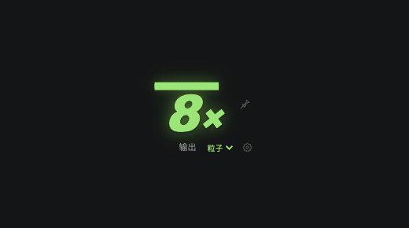

# dsh-combo

[English](README.md) | 简体中文

dsh-combo 是 DeepSeek Harness（DSH）的轻量级插件，可在 DSH Web 界面和 DSH Desktop 桌面应用中显示每轮思考与工具调用连击数。每次完整模型输出（`assistant/message`）和已提交的 `tool/call` 各加一，到当前 turn 边界时清零。



## 功能

- 实时监听流式输出（`assistant/live-chunk`）计算 token 连击，打字机实时暴击，爽感拉满！同时兼容 Host 提供的 `dshCombo` 会话投影与持久化工具调用。
- 默认按 turn 计数；可通过 `expireMs` 选择启用空闲超时；支持通过 `tokensPerCombo` 调整每次连击所需 token 比例。
- 显示最近调用的工具/思考状态、分档视觉反馈、可选音效，并可按会话 pin 连击，在多轮之间累计。
- 在侧栏**插件**页有独立的配置页，全部设置（含音效开关、音量、起播连击数）保存到 profile 并立即生效。
- 运行在 DSH Web Client 中，也支持内嵌同一 Web 应用的 DSH Desktop。不修改发给模型的内容，也不连接第三方服务。Pin 状态保存在客户端页面的 `localStorage`。

## 通过官方 CLI 安装

这是独立开发的社区插件，通过官方 `dsh plugin` CLI 安装，不代表 DeepSeek 官方出品。代码为可直接运行的 JavaScript，无安装期构建脚本。

按你使用的 profile 安装。Web 和 Desktop 使用不同的 profile：

```sh
# DSH Web 界面
dsh plugin --profile web add github:QuentinCrane/dsh-combo

# DSH Desktop
dsh plugin --profile desktop add github:QuentinCrane/dsh-combo
```

使用 DSH Desktop 时，先启动一次应用以初始化 profile，再完全退出应用，然后运行 Desktop 附带的 `dsh` 命令。如果终端里找不到该命令，先在应用的 **Manage dsh Command** 菜单中启用它。安装后重新打开 Desktop。详见 [DSH 官方 Desktop 指南](https://github.com/deepseek-ai/deepseek-harness/blob/master/apps/desktop/README.md#bundled-command-runtime)。

如果要安装本地 checkout，请把路径替换为包含 `package.json` 的目录：

```sh
dsh plugin --profile <profile> add link:/absolute/path/to/dsh-combo
```

启动前可以确认 bundle layer 已加入：

```sh
dsh --profile web --dump-config
dsh --profile web
```

插件由 Host 会话投影和 DSH Client 模块两部分组成。DSH Desktop 内嵌了同一套 Web 应用，因此安装到 `desktop` profile 后也会运行。DSH 要求 Client 模块声明 `platform: web`；这是 Client 运行时契约，并不代表插件只能在独立的 Web profile 中使用。安装或修改包文件后，请重启 profile，除非当前 HMR 设置已经应用了修改。

## 配置

### 在界面里配置

打开侧栏的**插件**页，选中 `dsh-combo` 组合包，使用它页面上的配置区。所有设置都在那里——包括音效开关、音量与起播连击数——保存后写入 profile 的行配置并立即生效，不需要重启，也不需要刷新页面。

HUD 上的齿轮面板仍然保留，作为「本机快速调整」：只对当前浏览器预览，并存在本机存储里。在插件页保存同一个键会清掉该键的本地覆盖，因此以 profile 配置为准；面板上的**恢复默认设置**会清空全部本地覆盖，回到配置值。

### 在 profile patch 里配置

`cordis.patch.yml` 提供可用的默认值。要手动覆盖配置，在 profile 的 `cordis.patch.yml` 里添加一个更靠后的 `dsh-combo` 行：

```yaml
- id: dsh-combo
  config:
    enabled: true
    showToolName: true
    animation: normal
    particles: true
    preset: particles
    timerMs: 10000
    powerThreshold: 0
    effectFrequency: 1
    shake: true
    shakeIntensity: 3
    scale: 1
    offsetX: 18
    offsetY: 10
    barHeight: 7
    particleCount: 0
    particleSize: 4
    particleSpread: 1
    effectDurationMs: 820
    glow: 1
    accentColor: ''
    numberColor: ''
    showGain: true
    showTimer: true
    position: top-right
    excludeTools: []
    expireMs: 0
    sound: false
    soundTheme: blip
    soundVolume: 0.35
    soundFrom: 10
    pinPromptMs: 5000
```

DSH patch layer 会替换该行完整的 `config` 对象。覆盖时，请把想保留的设置一并写上。

| 设置 | 默认值 | 说明 |
|---|---:|---|
| `enabled` | `true` | 显示 HUD。 |
| `comboMode` | `hybrid` | 连击计算模式：`hybrid`（混合模式：流式 Token 打字暴击 + 工具调用全开）、`tokens`（仅流式 Token 打字连击）、`tools`（经典模式：仅在工具调用与思考回合完成时累加 +1）。 |
| `showToolName` | `true` | 在计数器下方显示最近调用的工具。 |
| `animation` | `normal` | `off`、`normal` 或 `strong`；`strong` 使用幅度更大的弹跳动画。系统减少动态效果设置会关闭 CSS 动画。 |
| `particles` | `true` | 动画开启时，每次连击增长触发当前预设的特效，连击越高粒子越密。 |
| `preset` | `particles` | 默认特效预设：`particles`（晶莹粒子）、`fireworks`（绚烂烟花）、`slash`（光刃斩击）、`aura`（超赛气焰）、`glitch`（赛博故障）。 |
| `position` | `top-right` | `top-right`、`top-left`、`bottom-right` 或 `bottom-left`。 |
| `excludeTools` | `[]` | 忽略的工具名，不区分大小写。 |
| `expireMs` | `0` | 可选的空闲重置时长，单位毫秒；`0` 表示无限模式（永不清零）。支持快捷预设 `[ ∞ 无限 | 5秒 | 10秒 | 30秒 | 60秒 ]`。最大值：`600000`。 |
| `sound` | `false` | 播放打击音效；密集调用合并为一次。 |
| `soundTheme` | `blip` | 音效风格主题：`blip`（轻柔敲击）、`keyboard`（机械轴音）、`bubble`（治愈气泡）、`arcade`（复古街机）、`laser`（未来激光）、`melodic`（动态音阶）。 |
| `soundVolume` | `0.35` | 音量，范围 `0`–`1`。 |
| `soundFrom` | `10` | 从第几次连击开始播放声音，范围 `0`–`1000`。 |
| `pinPromptMs` | `5000` | turn 结束后，至少有 2 次调用的连击可被 pin 的停留时间。最大值：`60000`；`0` 表示不提示。 |

无效的枚举值会回退到默认值；数值会被夹在对应范围内。Host 半侧把每项设置都声明为 Schemastery `Config` 的 volatile 字段，这正是它们出现在插件页、并且写入后无需重启即可生效的原因。

## 自定义外观与节奏

点击计数器旁的齿轮可即时调整外观、倒计时与特效。选择保存在本机；“恢复默认设置”清除本机覆盖并恢复配置文件的值。

倒计时条直观反映当前连击的剩余有效时长：设置 `expireMs` 时，倒计时条实时倒数并在归零时触发连击清零；设为 `0`（或快捷点击「∞ 无限」）时为无限模式，连击不会随时间衰减，Pin 亦可跨轮保留 streak。

| 设置 | 默认值 | 范围 | 说明 |
|---|---|---|---|
| `expireMs` | `0` | 0–600000 ms | 空闲重置时间；`0` 为无限模式（永不清零）。配置界面提供一键快捷选项。 |
| `timerMs` | `10000` | 1000–60000 ms | 倒计时条基准时长；开启空闲重置时优先使用 `expireMs`。 |
| `powerThreshold` | `0` | 0–1000 | 从第几次连击开始启用反馈和特效。 |
| `effectFrequency` | `1` | 1–20 | 每几次连击触发一次粒子特效；批量调用跨过触发点时也会触发。 |
| `shake` | `true` | 布尔值 | 独立开关连击抖动。 |
| `shakeIntensity` | `3` | 0–12 px | 抖动幅度。 |
| `scale` | `1` | 0.5–2 | 计数器和粒子整体缩放。 |
| `offsetX` | `18` | 0–240 px | 距左右边缘的距离。 |
| `offsetY` | `10` | 0–240 px | 垂直边距；顶部避开窗口栏。 |
| `barHeight` | `7` | 2–16 px | 倒计时条高度。 |
| `particleCount` | `0` | 0–80 | 每次爆发的粒子数量；`0` 按连击分档自动增长。 |
| `particleSize` | `4` | 1–12 px | 粒子大小。 |
| `particleSpread` | `1` | 0.25–2 | 扩散距离倍率。 |
| `effectDurationMs` | `820` | 200–2500 ms | 粒子动画持续时间。 |
| `glow` | `1` | 0–2 | 光晕强度；`0` 关闭光晕。 |
| `accentColor` | `''` | #RRGGBB 或空字符串 | 自定义光晕与粒子颜色；空字符串随连击数分档变色。 |
| `numberColor` | `''` | #RRGGBB 或空字符串 | 自定义数字与进度条颜色；空字符串随连击数分档变色。 |
| `showGain` | `true` | 布尔值 | 显示 `+N` 增量提示。 |
| `showTimer` | `true` | 布尔值 | 显示倒计时条。 |

设计参考 [VS Code PowerMode](https://github.com/hoovercj/vscode-power-mode)：用剩余时间表示连击节奏，以触发门槛和频率调节特效，预设与独立自定义参数组合使用。本插件使用 CSS 动画与 DSH 会话投影实现，完整模型输出与工具调用共同驱动反馈。

## 显示规则

一次思考按模型的一轮完整输出计数，即使模型不提供显式推理文本也适用，标签显示为「思考」。流式片段、失败重试、中断输出、历史替换和同一 turn/step 的重复结算不计数。思考与工具调用都会补满倒计时。

| 连击数 | 显示效果 |
|---|---|
| 1–9 | 绿色粗体倍率、顶部亮条和微光和像素粒子 |
| 10–19 | 更大倍率、黄绿色光晕和更多粒子 |
| 20–49 | 黄色光晕、轻微抖动和更密集的粒子 |
| 50+ | 橙色光晕、最大倍率和最密集的粒子 |

HUD 使用 PowerMode 风格的「数字 × + 顶部亮条」，无卡片底色。计数器下方的样式下拉框可即时切换 5 种不同维度的视觉特效预设（晶莹粒子、绚烂烟花、光刃斩击、超赛气焰、赛博故障），并预览一次动画。选择保存在本机 `localStorage`，优先于配置中的默认 `preset`，不改变连击计数。所有预设统一随 combo 数量变色：1–9 绿色、10–19 黄绿、20–49 黄色、50–99 橙色、100+ 紫晶、200+ 霓虹青、300+ 赤红、500+ 幻彩。预设改变动画形态，色调风格与手动自定义颜色仍优先。

点击 📌 可将当前会话的连击保持为 streak。未 pin 的 turn 结束后，至少 2 次调用的连击会按 `pinPromptMs` 暗色停留；在这段时间内 pin，即可在后续 turn 继续累计。Pin 状态会保存到本地存储，刷新页面后仍然保留。

## 仓库结构

```text
dsh-combo/
├── index.js              # Host 会话投影和配置路由
├── client.js             # DSH Client 模块和悬浮 HUD
├── cordis.patch.yml      # 可安装的 DSH bundle layer
├── package.json          # Bundle 与 Client 模块清单
├── test/                 # 使用本地运行时替身的 Host / Client 单元测试
├── docs/                 # 开发、发布与故障排查说明
├── README.md
├── README.zh-CN.md
├── CONTRIBUTING.md
├── CHANGELOG.md
└── LICENSE
```

## 开发

运行本地单元测试：

```sh
npm test
```

Client 从 `uiSession.adapter.current` 读取当前 binding，再通过 `sessions.binding(id).session.projections.faceOf('dshCombo')` 订阅投影。Host 负责折叠已提交的会话事件。`dsh.client.inject` 声明包之间的关系；Client 插件导出的 Cordis `inject` 数组声明运行时需要等待的服务。

发布与 npm 分发说明见 [docs/publishing.md](docs/publishing.md)：release workflow 会先跑测试，配置 `NPM_TOKEN` 后把当前版本发布到 npm，并始终创建带 tarball 的 GitHub Release。

官方 bundle 和 Client 规范：[DSH 插件发布指南](https://github.com/deepseek-ai/deepseek-harness/blob/master/docs/user/develop/basic/publish.md)、[Client Modules 参考](https://deepseek-harness.github.io/deepseek-harness/en/reference/subsystems/client-modules)、[Session Projections 参考](https://deepseek-harness.github.io/deepseek-harness/en/reference/subsystems/session-projection)、[官方 Client 包规范](https://github.com/deepseek-ai/deepseek-harness/blob/master/packages/client/AGENTS.md)和 [Desktop 指南](https://github.com/deepseek-ai/deepseek-harness/blob/master/apps/desktop/README.md)。DSH 目前处于 developer preview，后续版本可能引入破坏性 API 变更。

如需在 GitHub 上被 DSH 插件目录发现，请为仓库添加 `dsh-plugin` topic。
